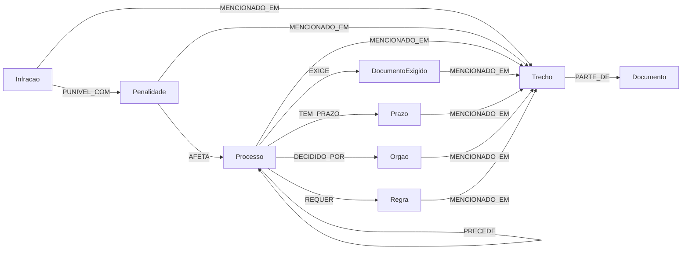

# Modelo conceitual do grafo (LPG)

## Diagrama

## Nós e propriedades

| Rótulo | Propriedades | Observações |
|---|---|---|
| `Documento` | `id`, `titulo`, `tipo`, `numero`, `data`, `ano`, `arquivo` | Um por PDF |
| `Trecho` | `id`, `documento_id`, `secao`, `texto`, `pagina`, `ano`, `embedding` | Artigo ou seção; guarda o vetor |
| `Processo` | `id`, `nome`, `aliases`, `descricao`, `embedding` | Trancamento, Monitoria, Sindicância... |
| `Regra` | `id`, `nome`, `aliases`, `descricao` | Condição ou limite |
| `Infracao` | `id`, `nome`, `aliases`, `gravidade` | `gravidade`: leve, media, grave, gravissima |
| `Penalidade` | `id`, `nome`, `aliases`, `descricao` | Advertência, repreensão, suspensão, desligamento |
| `Orgao` | `id`, `nome`, `aliases` | Reitor, Consepe, Coordenação, SEGEN... |
| `Prazo` | `id`, `valor`, `unidade`, `tipo_dia`, `descricao` | `tipo_dia`: uteis, corridos |
| `DocumentoExigido` | `id`, `nome`, `aliases` | Atestado com CID, histórico escolar... |

## Relações

| Relação | Direção | Exemplo |
|---|---|---|
| `PARTE_DE` | Trecho → Documento | Art. 15 faz parte do Código Disciplinar |
| `MENCIONADO_EM` | qualquer entidade → Trecho | Origem de cada fato (rastreabilidade) |
| `EXIGE` | Processo → DocumentoExigido | Segunda chamada exige atestado |
| `TEM_PRAZO` | Processo → Prazo | Recurso tem 5 dias úteis |
| `DECIDIDO_POR` | Processo → Orgao | Recurso decidido pelo Consepe |
| `REQUER` | Processo → Regra | Monitoria requer não ter sanção |
| `PRECEDE` | Processo → Processo | Sindicância precede o PAD |
| `PUNIVEL_COM` | Infracao → Penalidade | Plágio punível com desligamento |
| `AFETA` | Penalidade → Processo | Sanção grave afeta a monitoria |

Sugestão para a Fase 2: guardar nas relações a propriedade `trecho_id` (de onde a relação foi extraída) e `ano` do documento.

## Convenções

- **`id` canônico:** texto minúsculo, sem acento e com `_` (ex.: `trancamento_de_matricula`). É a chave de unicidade de cada rótulo.
- **`nome`:** forma legível para exibir. **`aliases`:** lista de sinônimos (ex.: Penalidade `desligamento` com alias `expulsao`).
- **Resolução de entidades (Fase 2):** antes de criar um nó, procurar pelo `id` canônico ou por um alias; só criar se não existir (`MERGE`).
- **Versões:** `Trecho.ano` permite distinguir regras de 2020 e 2026.

## Índices (resumo; ver `neo4j/schema.cypher`)

- Constraints de unicidade em `id` para todos os rótulos.
- Range: `Trecho.documento_id`, `Trecho.ano`, `Infracao.gravidade`, `Processo.nome`.
- Fulltext: `Trecho.texto`; `nome` e `aliases` das entidades.
- Vetorial (cosseno): `Trecho.embedding` e `Processo.embedding`.

## Possíveis extensões (Fase 2/3, se o grupo quiser)

`REMETE_A` (para documentos externos citados), `CONFLITA_COM` (regras que divergem entre versões), `SINONIMO_DE`.
